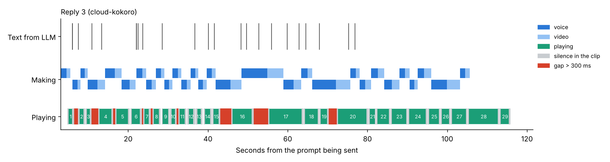
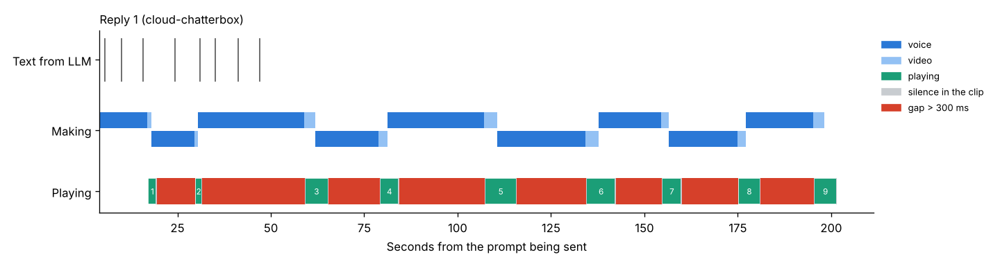

# Where the pauses come from in a long reply (R129)

Larry heard a long reply spoken slowly, then a pause, then more (roadmap item 107). This
experiment measures, before any change, how fast a long reply is spoken and where every pause in
it comes from: the voice's own speed, the clips, the time each clip takes to make, or the LLM.
Its result decides R130's fix.

## How to run it

Three pieces: a stand-in for the LLM (optional), the app with each clip's words noted, and the
measurement.

```
python experiments/long_reply/fake_llm.py                    # llama-server's place, port 8080
python experiments/long_reply/serve_logged.py long-reply/clips.jsonl
python experiments/long_reply/long_reply.py long-reply/clips.jsonl --label laptop-kokoro
python experiments/long_reply/long_reply.py long-reply/clips.jsonl --label laptop-clone \
    --voice-sample <data folder>/uploads/voice-sample.wav
```

- **fake_llm.py** answers as llama-server does, with the three long replies in
  [replies.py](replies.py) (152, 220 and 261 words, written as Gemma 3 4B answers in the app),
  written a word at a time at Gemma's pace on 2 threads measured in R96 (4.5 tokens a second, the
  first token after 1.5 s; `--tokens-per-second` and `--first-token-s` change them). So every run
  speaks the same words at the same pace, and only the voice, the video and the playback differ.
  With the real llama-server running instead, the replies are Gemma's own.
- **serve_logged.py** runs the app exactly as `imageskin serve` does, but notes each reply
  clip's text, words, speech length and the silence it starts and ends with in the JSONL file
  (the API doesn't give a clip's text, and the speech is removed once its video is made).
- **long_reply.py** sends each prompt with R96's `time-reply` (`time_reply.measure`), joins each
  clip's row with its noted line, works out the rates and the cause of every gap, then speaks
  each reply again outside the app for the voice's own rate. The tables go to
  `long-reply/long-reply-<label>.md` and `.json`, and a timeline of each reply to
  `timeline-<label>-<n>.png` when matplotlib is installed. The log has
  `Long reply experiment started`, `Long reply measured` for each reply with its rate and gaps,
  `Own rate measured` with the time it took, and `Long reply experiment done`.

The app must be set up and accepted first (a person prepared, in the voice to measure). The
cloned voice is the person's own when Chatterbox is installed; otherwise Kokoro speaks.

### On the hosted machine

The app there is in its Docker image, which leaves `experiments/` out, and llama-server is the
real Gemma, so Gemma writes the replies to the three prompts (no fake_llm.py). The steps stop the
site's app, run the same image in a one-off container named `long-reply` under serve_logged.py
with this folder mounted, measure inside it, and then put the site back. The site is down while
it runs: about 10 to 15 minutes with a ready-made voice (2 to 5 a reply,
and nothing is printed until each reply ends), and up to 30 with your own cloned voice.

Before you start, the chat must work on the site (a person set up and accepted, or chosen with
Start now). The three prompts and their replies are added to the chat's history. If the chat
isn't open, the first prompt is refused and the run stops with `The app refused the prompt` and
the reason.

On the hosted machine, in the folder you cloned for the site with deploy/README.md's
`git clone` (`~/github/ImageSkinForLLM` on Larry's machine):

```
cd ~/github/ImageSkinForLLM
git fetch origin
git checkout long-reply-pauses-experiment
cd deploy
docker rm -f long-reply 2>/dev/null
docker compose stop app
docker compose run -d --name long-reply -v "$PWD/../experiments/long_reply:/exp:ro" app \
    python /exp/serve_logged.py /data/long-reply/clips.jsonl --config /etc/imageskin/config.toml
docker exec -w /exp long-reply python long_reply.py /data/long-reply/clips.jsonl \
    -o /data/long-reply --label hosted --no-own-rate
docker exec long-reply cat /data/long-reply/long-reply-hosted.md
docker rm -f long-reply
docker compose start app
cd ..
git checkout main
```

`long_reply.py` waits for the app to start (`Waiting for the app to start` in its log), logs
`Long reply experiment started`, `Long reply measured` once for each reply, and
`Long reply experiment done`, then prints the tables. The `cat` line prints the same tables again
on their own: that output is what to paste. `--no-own-rate` skips speaking the replies again
outside the app, which would need the voice the site uses named on the command line; the
**Speech rate** column gives the voice's own pace from the clips themselves. The JSON with every
number is beside it, in `/data/long-reply/long-reply-hosted.json`.

## What it measures

For each clip, in order:

| Column | What it is |
|---|---|
| Words, Ends at | the clip's words, and where its text ends: a full stop, list item or heading (`sentence`), a comma, semicolon, colon or dash (`clause`), or mid-clause (`none`) |
| Text came | the clip's text came from the LLM (ms from Send) |
| Waited | it waited for the clip before it to be made |
| Voice, Video | its voice step, and its video step until the clip was whole |
| First byte, Plays, Seconds | as in `time-reply`: its first bytes arrived, when it plays (once it has arrived and the clip before has ended) and how long it plays |
| Speech s, Start/end silence | its speech's length, and the silence the speech starts and ends with (quieter than 35 dB below its loud level, measured with the app's `mouth_sync.heard`, as R127
measured the voice) |
| Ready before end | how long before the clip before it ended it was ready to play (negative: after) |
| Gap | playback waiting for it: the silence heard because it wasn't ready |
| Pause heard | the whole silence heard before it: the end of the clip before, the gap and its own start |
| Cause | why there was a gap: `queued` (made behind the clips before it, so clips are made slower than they play), `text late` (its text came only after the clip before had started playing) or `slow to make` |

For each reply: the speaking rate heard (words a minute from the first word to the end of the
last clip), the rate inside the clips (gaps left out), the **speech rate** (the clips' speech
with the silence at their starts and ends left out: the voice's own pace as the app spoke it),
the voice's **own rate** (the reply spoken
a whole sentence at a time outside the app, the silence at each sentence's start and end left
out; a sentence at a time because Chatterbox stops at about 40 s of speech), the LLM's writing
rate, the time to make the clips against how long they play, the gaps and pauses over 0.3 s and
how many come mid-sentence, the clips cut from the same text in one go (**Cut together**), and the
silence the clips' own starts and ends add at the joins.

## Results: cloud session, 2026-10-26

A 4-core cloud machine with no graphics card, the photoreal engine with a default person's photo
prepared (`photoreal_male_professor.jpg`), fake_llm.py at Gemma's cloud pace, Kokoro's af_heart
(the ready-made voice) and then Chatterbox Turbo cloned from the setup samples' recording (as a
person's own voice), on main with R128's mouth sync (#174, #175). Both runs were made with the
code in this PR, so every number in the JSON comes from it. The hosted machine's results are in
the next section. Full tables: [Kokoro](results/long-reply-cloud-kokoro-2026-10-26.md) and
[Chatterbox](results/long-reply-cloud-chatterbox-2026-10-26.md), with the JSON beside them.

| Voice | Reply | Words | Clips | First word heard | Rate heard | Speech rate | Own rate | Make/play | Gaps (total) | Pauses heard > 0.3 s | Of them mid-sentence | Silence at joins |
|---|---|---|---|---|---|---|---|---|---|---|---|---|
| Kokoro | 1 | 152 | 9 | 7.6 s | 125 | 182 | 181 | 1.22 | 5 (15.2 s) | 8 | 1 | 6.4 s |
| Kokoro | 2 | 220 | 15 | 5.2 s | 150 | 219 | 217 | 1.17 | 10 (15.5 s) | 14 | 3 | 11.0 s |
| Kokoro | 3 | 261 | 29 | 4.7 s | 141 | 214 | 210 | 1.05 | 9 (12.9 s) | 28 | 11 | 21.9 s |
| Chatterbox | 1 | 152 | 9 | 17.1 s | 49 | 198 | 200 | 3.90 | 8 (134.7 s) | 8 | 1 | 3.0 s |
| Chatterbox | 2 | 220 | 13 | 15.3 s | 51 | 220 | 224 | 4.08 | 12 (193.4 s) | 12 | 1 | 4.1 s |
| Chatterbox | 3 | 261 | 20 | 12.7 s | 48 | 219 | 223 | 4.18 | 19 (247.1 s) | 19 | 2 | 7.6 s |





The pauses have three causes.

1. **Clips not ready in time, with either voice.** With Chatterbox a clip takes about 4 times as
   long to make as it plays (the voice step is about 8 times the video step), so every clip
   after the first waits behind the one before (all 39 gaps `queued`, 2.5 to 43 s, mostly 9 to 25 s) and a
   reply is heard at 48 to 51 words a minute. Kokoro makes its clips at 1.05 to 1.22 times the
   time they play, so they queue too, with gaps of 0.3 to 6.6 s (5 to 10 a reply). Both are
   slower than in a first run the day before on another cloud machine and on main without
   #174 and #175 (Kokoro 0.7 times, no gaps; Chatterbox 2.2 times, 76 to 83 words a minute
   heard): the voice and video steps take about twice as long in the app here, while Kokoro
   outside the app is only a little slower. This run doesn't tell the machine from the code
   apart; R130 should time the voice step on its own before and after #175.
2. **Silence at every join.** Kokoro starts every clip with about 315 ms of silence and ends it
   with about 455 to 495 ms, so about 0.8 s is heard at each join even with no gap, 6 to 22 s a
   reply. Chatterbox leaves less (about 115 ms and 230 ms) and has fewer, longer clips, 3 to 8 s
   a reply. With the silence left out, the clips speak at the voice's own pace (Kokoro 182 to
   219 words a minute against 181 to 217 outside the app, Chatterbox 198 to 220 against 200 to
   224). Nothing is stretched: each clip plays as long as its speech (within 50 ms).
3. **Joins where no pause belongs.** When the voice waits for text, as Kokoro's does in reply 3
   once it has caught up, R100's cut for a waiting voice chops the sentence: 11 of reply 3's 28
   pauses come mid-sentence, as in "where the staff can watch / you run and suggest / a pair that
   suits". `SentenceSplitter.feed` keeps cutting in the same call, because `voice_waiting()`
   still says True until the pieces are handed over, so the text written while the voice was
   busy is chopped into pieces of 3 to 5 words at once (7 clips in reply 3 were cut together
   this way), each cut at five words if no comma comes first. Each piece is a clip of its own,
   with the 0.8 s of silence around it. With the voice always busy (Chatterbox, and the hosted
   machine below), the clips stay whole sentences.
4. **The LLM mostly keeps up.** At Gemma's cloud pace it writes 203 to 216 words a minute, about
   Kokoro's own pace, so 3 of Kokoro's gaps (0.4 to 1.4 s) were `text late`; none of
   Chatterbox's were.
5. **The browser adds little at a join.** R127 measured the switch between clips: the next
   clip's first frame shows 85 to 91 ms before its sound, at rest, and its sound follows at once.
   So the pauses heard are the clips' own silence and the gaps above, not the player.

## Results: hosted machine, 2026-10-26

Larry's hosted machine (4 Ampere cores, the app capped at 3, llama-server with Gemma 3 4B on 2
threads), with the person speaking in Larry's own voice with another accent: Kokoro's am_michael
and then Chatterbox's converter. Gemma wrote the replies itself, and the run used `--no-own-rate`.
Full tables: [hosted](results/long-reply-hosted-2026-10-26.md). This run was made before the
silence at a clip's start and end was measured with the app's `mouth_sync.heard` (it took the
95th percentile of the loudness, not the 98th), so its start/end silence and speech rate may be
a little off; its gaps, rates heard and times to make are measured the same way as now.

| Reply | Words | Clips | First word heard | Rate heard | Rate in clips | Speech rate | Make/play | Gaps (total) | Of them queued | Pauses heard mid-sentence | Silence at joins |
|---|---|---|---|---|---|---|---|---|---|---|---|
| 1 | 199 | 18 | 287.6 s | 48 | 128 | 155 | 2.79 | 16 (157.7 s) | 16 | 1 | 14.8 s |
| 2 | 109 | 9 | 13.8 s | 53 | 136 | 165 | 2.76 | 8 (75.2 s) | 8 | 1 | 7.1 s |
| 3 | 200 | 20 | 14.3 s | 47 | 135 | 169 | 2.95 | 19 (163.8 s) | 19 | 1 | 16.8 s |

1. **Here the pauses are clips not ready in time, as in the cloud.** Making a clip takes 2.8 to 2.95 times as long as it plays, so after the first clip
   every clip waits behind the one before: all 43 gaps are `queued`, mostly 2 to 18 s, and a reply
   is heard at 47 to 53 words a minute, a third of the voice's own pace (155 to 169 inside the
   clips with their silence left out). Over half of the time a reply is heard is waiting.
2. **The voice has a large fixed cost per clip.** A clip of 2 s of speech takes 6 to 12 s to
   make, the first clips of a reply about 12 s, while a clip of 9 s takes 17 to 20 s. So short
   clips are the slowest for their length, and fewer, longer clips would be made faster per word.
   Most of the time is the voice step; the video step is a tenth of it.
3. **Nothing is chopped here.** The voice is always busy, so R100's waiting cut never fires (no
   clip was cut together) and the clips are whole sentences; only the first clip of each reply is
   its first few words (R100's first clause). Each clip still starts with about 390 ms of silence
   and ends with about 550 ms, so the joins add 7 to 17 s a reply on top of the gaps.
4. **The LLM keeps up.** Gemma writes 190 to 234 words a minute, and no gap was `text late`. The
   first reply's first word came at 287.6 s only because it waited for the app's warm-up after
   start; the others were heard at about 14 s, almost all of it the first clip's voice step.
5. **Two replies ended mid-sentence** ("The Rover Safety Bicycle, introduced in 1" and
   "Don't run every day, especially when"): Gemma's reply
   hit the reply's token limit. That is a separate issue from the pauses.

### What R130 should fix

- **Trim each clip's silence to the pause its text calls for**: the silence Kokoro leaves at a
  clip's start and end cut down (the start to about 50 ms, so the mouth's rest frame stays before
  the voice, R127), and a natural pause put back only where the text has one: longer at a full
  stop or paragraph, short at a comma, none mid-clause. Once the clips keep up, that alone
  brings Kokoro to about 200 words a minute, so R130's 150 to 170 is reached with the pauses at full stops and
  commas, not by slowing the voice. It is done to the speech before the frames are made, so the
  mouth (R128) follows it.
- **Cut once per waiting voice**: `SentenceSplitter.feed` hands over at most one waiting cut per
  call (or `voice_waiting` counts a cut as soon as it is made), and a waiting cut falls only at a
  clause boundary, never by word count after the first clause, so a sentence is never chopped
  into pieces of a few words.
- **Keep up with a slow voice**: when clips are made slower than they play (the cloned voice
  in the cloud at about 4 times real time, Kokoro there at 1.05 to 1.22, and the hosted
  machine's voice at 2.8 to 2.95), start playback once enough is made that the rest,
  at the measured pace, keeps up to the end (R130's second point), or speak the reply in larger
  pieces so the voice has fewer starts. For Chatterbox at 4 times real time on 4 cores, keeping
  up means a long first wait (about three quarters of the reply's length); a faster clone
  (Pocket TTS, R22f) is the other way. On the hosted machine the voice's fixed cost per clip is
  the first thing to cut: fewer, longer clips (whole sentences joined up to a few seconds of
  speech, after the first clause) and a faster voice path there, measured again with this
  experiment.
- **Find why the voice and video steps were twice as slow in the second cloud run**: time them
  on one machine on main before and after #175, so a slowdown from the mouth sync, if there is
  one, is fixed with the rest.
